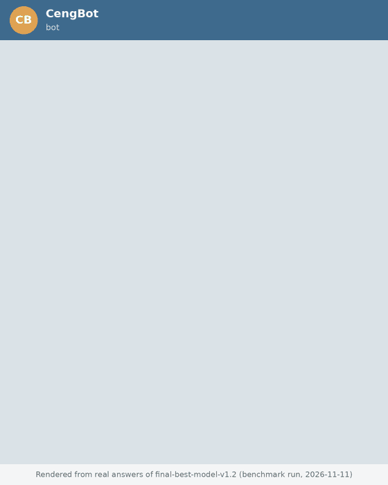
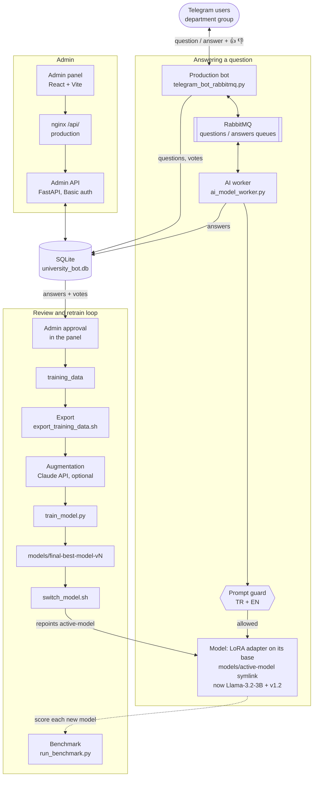

# CengBot - AI-Powered University Assistant

<div align="center">


A fine-tuned open-weight LLM (**currently Llama-3.2-3B + LoRA**) that answers students' questions for the Çukurova University Computer Engineering Department in Telegram, with a review-and-retrain loop.

**Try the Bot**: [@cu_ceng_v1_bot](https://t.me/cu_ceng_v1_bot)  
**HuggingFace**: [Naholav](https://huggingface.co/Naholav)  
**Contact**: arda.mulayim@outlook.com  
**Last updated**: November 2026 ([CHANGELOG](CHANGELOG.md))

[](https://python.org)
[](https://react.dev)
[](https://vite.dev)
[](https://fastapi.tiangolo.com)
[](https://rabbitmq.com)
[](https://sqlite.org)
[](LICENSE)



<sub>Rendered from real answers of the v1.2 model (benchmark run, 2026-11-11)</sub>

</div>

---

## Overview

CengBot answers questions about courses, internships, graduation, staff and
the department in a Telegram group, in Turkish or English. The answers come
from an open-weight base model with a LoRA adapter fine-tuned on department
Q&A data. The production model is Llama-3.2-3B + LoRA v1.2; any other
open-weight family (Qwen, Mistral, Gemma, Phi, ...) can be trained and swapped
in (see [Supported base models](#supported-base-models)).

Every question and answer is stored. Admins review them in a web panel,
correct answers and approve good pairs for training. The approved data is
exported, optionally augmented with the Claude API, and used to train the next
model version, which is scored on a fixed 100-question benchmark and swapped
in with one command. The project started with about 600 English and 600
Turkish question-answer pairs, which augmentation expanded to more than 22,000
training pairs.

## Features

- **Telegram bot** (`src/telegram_bot_rabbitmq.py`): answers in one configured
  group (optionally one forum topic), 👍/👎 voting (one vote per user, at most
  two changes), 5 messages per minute per user, many questions in flight at
  once, long answers split to fit Telegram's limit.
- **Inference worker** (`src/ai_model_worker.py` + `src/llama_model_handler.py`):
  base model + LoRA from `models/active-model`, loaded offline-first from
  `model_cache/`; Turkish/English detection, short answers (4 sentences by
  default); retries with exponential backoff, and a question that keeps
  failing gets an apology after 3 attempts instead of being requeued forever.
- **Prompt guard** (`src/prompt_guard.py`): rule-based jailbreak and
  prompt-injection filter for Turkish and English. Blocked or over-long
  questions never reach the model.
- **Admin API + panel** (`src/admin_rest_api.py`, `admin_frontend/`): FastAPI
  with HTTP Basic auth on every data endpoint; React + Ant Design panel (Vite)
  to browse, edit, approve and delete questions, see training data,
  statistics, duplicates, docs and logs.
- **Training pipeline** (`src/train_model.py`): the training prompt is
  byte-identical to the inference prompt, the loss covers the answer and EOS
  only, and the train/validation split keeps a question and its augmented
  variants on the same side. Bf16 LoRA or QLoRA, any supported base family.
- **Model versioning**: `models/final-best-model-v<N>/` directories, the
  `models/active-model` symlink and `scripts/switch_model.sh` (validate,
  switch, roll back; restarts only the worker).
- **Benchmark** (`benchmark/`): 100 verified TR/EN questions, a deterministic
  grader plus an optional LLM judge, and a leaderboard.
- **Operations**: start/stop/health scripts, systemd units, nginx deployment,
  log rotation, a system monitor, Excel export and backups.

## Architecture



1. The bot stores the question in `raw_data`, publishes it to the `questions`
   queue and waits up to `BOT_ANSWER_TIMEOUT` seconds (default 30). An answer
   router hands each answer to the handler waiting for that question.
2. The worker runs the prompt guard, generates the answer, stores it and
   publishes it to the `answers` queue.
3. The bot replies in the group with 👍/👎 buttons. If no answer arrives in
   time it sends a fallback reply; the worker still stores the late answer.

Only `src/telegram_bot_rabbitmq.py` is a production bot. `src/telegram_bot.py`
(legacy) and `src/telegram_bot_standalone.py` (development, model in-process)
must never run next to it: they share the token, and Telegram rejects the
second poller with `409 Conflict`.

More detail: [docs/ARCHITECTURE.md](docs/ARCHITECTURE.md).

## Quick Start

**Requirements**: Linux (the scripts target Ubuntu), Python 3.11,
**Node.js 22.13+ or 24+** for the admin panel (Ubuntu's apt package is too old:
use [nvm](https://github.com/nvm-sh/nvm) or [nodejs.org](https://nodejs.org)),
RabbitMQ, and an NVIDIA GPU with CUDA for inference and training (CPU works but
is very slow). Access to the gated
[`meta-llama/Llama-3.2-3B`](https://huggingface.co/meta-llama/Llama-3.2-3B)
base model is needed once, to download it into `model_cache/` (other base
models: [Supported base models](#supported-base-models)).

```bash
# 1. Clone
git clone https://github.com/naholav/cu_ceng_bot.git
cd cu_ceng_bot

# 2. Python 3.11 virtual environment (all scripts use .venv/bin/python)
python3.11 -m venv .venv
.venv/bin/python -m pip install -r config/requirements.txt
.venv/bin/python -m pip install -r config/requirements-dev.txt   # tests

# 3. Admin panel (Node.js 22.13+ or 24+)
(cd admin_frontend && npm install)

# 4. RabbitMQ
sudo apt install rabbitmq-server && sudo systemctl enable --now rabbitmq-server

# 5. Configuration
cp .env.example .env && chmod 600 .env
#    set at least TELEGRAM_BOT_TOKEN, TELEGRAM_ALLOWED_CHAT_ID and an admin password (see below)

# 6. Database tables (creates missing tables, keeps existing data)
.venv/bin/python -c "import sys; sys.path.insert(0, 'src'); from database_models import init_db; init_db()"

# 7. Check, then start
./scripts/test_environment.sh
./scripts/start_system.sh
```

`scripts/setup_system.sh` automates steps 2-6 on Ubuntu (apt packages,
`.venv` if missing, Python and npm dependencies, database, `.env` from the
template). It does not install Node.js: install it first.

**Model files are not in the repository** (`models/`, `model_cache/` and
`data/` are gitignored). Put a trained model directory into `models/` and
activate it with `./scripts/switch_model.sh switch <name>`, or train one (see
[Training](#training-and-data)). The first start downloads the base model into
`model_cache/` if `HUGGING_FACE_TOKEN` is set and downloads are allowed.

Once running: admin panel <http://localhost:3000>, API docs
<http://localhost:8001/docs>, health `./scripts/health_check.sh`.

## Configuration

All settings come from `.env`. **[`.env.example`](.env.example) is the full,
commented reference**; values already set in the process environment win over
`.env`. The most important ones:

| Variable | Purpose |
|---|---|
| `TELEGRAM_BOT_TOKEN` | Bot token from @BotFather (required) |
| `TELEGRAM_ALLOWED_CHAT_ID` | The one group the production bot answers (default: the department group) |
| `TELEGRAM_TOPIC_ID` | Optional: only answer in this forum topic |
| `BOT_ANSWER_TIMEOUT` | Seconds the bot waits for the worker (default 30) |
| `RABBITMQ_HOST` / `_PORT` / `_USER` / `_PASSWORD` | Broker connection (empty user = guest, localhost only) |
| `QUESTIONS_QUEUE` / `ANSWERS_QUEUE` | Queue names, must match for bot and worker |
| `MODEL_PATH` | Optional override; empty = `models/active-model` |
| `BASE_MODEL_NAME` | Default base for training, and the fallback when an adapter does not name its base (default `meta-llama/Llama-3.2-3B`) |
| `HUGGING_FACE_TOKEN` | Only to download a gated base model (Llama, Gemma, most Mistral) |
| `MODEL_ALLOW_DOWNLOAD` / `HF_HUB_OFFLINE` | `false` / `1` forbids model downloads by the worker; training honours only `HF_HUB_OFFLINE=1` |
| `MODEL_LOAD_IN_4BIT` | `true` loads the base in 4-bit NF4 for inference (bases of ~12B+ on a 24 GB GPU; default `false`) |
| `MODEL_TRUST_REMOTE_CODE` | `true` executes Python code from the model repository; only for legacy remote-code models you trust (default `false`) |
| `LORA_TARGET_MODULES` | Training: `auto` (default), `all-linear` or a comma-separated list |
| `PROMPT_GUARD_ENABLED` / `PROMPT_GUARD_MAX_CHARS` | Prompt guard on/off (default on) and length limit (default 1000) |
| `API_HOST` / `API_PORT` | Admin API bind address: `127.0.0.1:8001` by default (put it behind the nginx `/api/` proxy instead of binding `0.0.0.0`) |
| `CORS_ORIGINS` | Exact origins the admin panel is served from |
| `ADMIN_USERNAME`, `ADMIN_PASSWORD_HASH` or `ADMIN_PASSWORD` | Admin login (see below) |
| `ANTHROPIC_API_KEY` or `CLAUDE_API_KEY` | Only for data augmentation and the benchmark's LLM judge |

`LORA_MODEL_PATH` is legacy and ignored.

### Admin login

There is **no default password**. Set `ADMIN_USERNAME` (default `admin`) and
one of:

- `ADMIN_PASSWORD_HASH`: the SHA-256 hex digest of the password (preferred), or
- `ADMIN_PASSWORD`: the plain password (used only when no valid hash is set).

If neither is set (or the value is a placeholder), every login is rejected with
401 and the API logs an ERROR at startup. Use an **ASCII-only** password: HTTP
Basic credentials are decoded as ASCII, so a password with `ç`, `ğ`, `ş` ... can
never log in. Generate the hash without the password ending up in your shell
history, then restart the Admin API:

```bash
python3 -c "import hashlib,getpass; print(hashlib.sha256(getpass.getpass().encode()).hexdigest())"
```

### Admin panel (Vite)

```bash
cd admin_frontend
npm start               # dev server on http://localhost:3000 (localhost only; npm start -- --host to expose it)
npm run build           # type check + production build into admin_frontend/build/
npm run preview         # serve build/ on http://localhost:3000
```

`REACT_APP_API_URL` (default `http://localhost:8001`) and
`REACT_APP_ADMIN_USERNAME` are baked into the panel when the dev server starts
or the build runs. They are read from the shell or from
`admin_frontend/.env.local` / `.env.development.local` / `.env.production.local`
(a shell variable wins), not from the root `.env`, so rebuild after changing
them. Vite exposes only variables prefixed `REACT_APP_` or `VITE_` to the
browser; never put secrets in them. Production builds ship no source maps
(`build.sourcemap: false` in `admin_frontend/vite.config.ts`). The origin the
panel is served from must be listed in `CORS_ORIGINS` unless it shares the
API's origin (the nginx setup from `deploy_production.sh` builds the panel with
`REACT_APP_API_URL=/api`).

## Running and Operations

```bash
./scripts/start_system.sh                 # worker, Admin API, bot, Vite dev server (manual mode)
./scripts/start_system.sh --no-frontend   # without the admin panel dev server
./scripts/start_system.sh --install-deps  # (re)install Python + npm dependencies first
./scripts/stop_system.sh                  # stops only this project's processes
./scripts/health_check.sh                 # read-only: services, /health, active model, disk/GPU, log sizes
```

In manual mode the services' output is appended to `logs/worker.log`,
`logs/bot.log`, `logs/admin.log` and `logs/frontend.log`, and the PIDs are kept
in `.pids`. A crashed service is not restarted. If Node.js is missing or older
than 22.13, `start_system.sh` starts everything except the panel and prints
an install hint.

**Production (systemd).** `sudo ./scripts/optimize_linux.sh --only services,logrotate`
installs the units `cengbot-worker`, `cengbot-bot`, `cengbot-admin` and
`cengbot-monitor` (`Restart=always`, output appended to `logs/*.log`) without
starting them; then run
`sudo systemctl enable --now cengbot-worker cengbot-bot cengbot-admin cengbot-monitor`.
Use one mode only: `start_system.sh` refuses to run while the units are active.
`scripts/deploy_production.sh` does the full setup (units, nginx with the
static panel and `/api/` proxy, health cron, optional firewall); see
[docs/DEPLOYMENT.md](docs/DEPLOYMENT.md).

**Logs and rotation**

- `logs/error.log` (errors with full tracebacks) is size-rotated by Python:
  10 MB × 5 files.
- The service logs (`worker.log`, `bot.log`, `admin.log`, `frontend.log`,
  `monitor.log`, ...) are rotated by **logrotate** with
  `config/logrotate/cengbot.conf` (50 MB, 5 compressed generations,
  `copytruncate`). Run it as your user with `./scripts/rotate_logs.sh`
  (`--install-cron` for an hourly crontab entry, `--dry-run` to preview), or
  system-wide with `sudo ./scripts/optimize_linux.sh --only logrotate`.
  `rotate_logs.sh` first tail-trims any log above 1 GiB
  (`CENGBOT_LOG_PRETRIM_BYTES`), so `copytruncate` never has to copy a huge file.
- Safety net: `start_system.sh` (and the worker restart in `switch_model.sh`)
  rotates any log above 50 MiB before starting a service, keeping its last
  10 MiB.
- `.venv/bin/python src/system_monitor.py --check-logs` reports log sizes and
  free disk space (exit code 1 on an alert; `--json`, `--once`).

## Supported base models

Training, validation, swapping and inference work with any open-weight causal
LM that the installed transformers supports natively: **Llama 3.x, Qwen2.5 /
Qwen3, DeepSeek-R1 distills, Mistral, Gemma 2/3, Phi-3.5 / Phi-4, GLM-4,
Granite 3.x, OLMo 2, Falcon3, SmolLM2/3**. The family details are handled
automatically: stop tokens, BOS handling, `<think>` blocks of reasoning models
removed from answers, LoRA targets (`auto`: q/k/v/o/gate/up/down_proj, or
all-linear for fused projections as in Phi and GLM) and eager attention for
Gemma training.

| Base size (24 GB GPU) | Training | Inference |
|---|---|---|
| up to ~4B | bf16 LoRA (default) | bf16 |
| 7-9B | `--load-in-4bit` (QLoRA), worker stopped | bf16 |
| ~12B and larger | `--load-in-4bit` | `MODEL_LOAD_IN_4BIT=true` |

```bash
./scripts/train_model.sh --dry-run --base-model Qwen/Qwen2.5-7B-Instruct
./scripts/train_model.sh --yes --base-model Qwen/Qwen2.5-7B-Instruct --load-in-4bit
./scripts/switch_model.sh validate final-best-model-v2
```

Repositories that need remote code (chatglm3, internlm2) work only with
`--trust-remote-code` / `MODEL_TRUST_REMOTE_CODE=true`, which executes the
repository's Python code: not recommended. Full family table, gated models and
the step-by-step sequence:
**[docs/MODEL_SWAP.md](docs/MODEL_SWAP.md#retrain-on-a-different-base-model)**.

## Model Swap

`models/active-model` is a symlink and the single source of truth for the model
the worker loads. Switching restarts only the AI worker; the bot and the API
keep running.

```bash
./scripts/switch_model.sh list                       # models, type, size, training info; marks the active one
./scripts/switch_model.sh validate final-best-model-v2
./scripts/switch_model.sh switch final-best-model-v2 # or: switch v2 (validates, switches, restarts the worker)
./scripts/switch_model.sh current                    # active model + validation
./scripts/switch_model.sh rollback                   # back to the previous model
./scripts/switch_model.sh restart                    # restart only the worker
```

Every command accepts `--dry-run`; `--yes` skips the questions. While the
worker reloads (a few minutes), users get the bot's fallback reply; their
questions stay in RabbitMQ and are answered and stored once the model is loaded.

**Step-by-step runbook (training → validation → switch → verification →
rollback): [docs/MODEL_SWAP.md](docs/MODEL_SWAP.md).**

## Training and Data

```bash
# Approved database rows -> data/cengbot_qa_augmented.jsonl (merges by default)
./scripts/export_training_data.sh [--approved-only] [--exclude-disliked] [--replace] [--include-inactive] [--no-backup] [--output FILE]

# Optional: 15 Claude-generated variations per approved pair (costs money, asks first)
./scripts/augment_training_data.sh --dry-run          # no API calls, no writes
./scripts/augment_training_data.sh [--max-items N] [--model ID] [--reset] [--yes]

# Train -> models/final-best-model-v<N>/ (never activates the model)
./scripts/train_model.sh --dry-run                    # data + tokenization stats only
./scripts/train_model.sh [train_model.py options]

# Training sessions (logs/training_history/)
./scripts/view_training_history.sh list | view v1 | compare v1 v2 | best
```

**`src/train_model.py` options** (all optional): `--dataset FILE...`,
`--base-model ID|DIR`, `--cache-dir`, `--models-dir`, `--output-name`,
`--checkpoint-dir`, `--log-dir`, `--epochs` (4), `--batch-size` (4),
`--eval-batch-size` (16), `--grad-accum` (16), `--lr` (2e-4), `--max-length`
(512), `--truncation drop|truncate`, `--val-ratio` (0.07), `--evals-per-epoch`
(5), `--early-stopping-patience` (3), `--seed` (42), `--lora-r` (16),
`--lora-alpha` (32), `--lora-dropout` (0.1),
`--lora-target-modules auto|all-linear|a,b,c`, `--load-in-4bit`,
`--trust-remote-code`, `--cpu`, `--workers` (4), `--semantic-dedup`,
`--no-db-export`, `--resume-from-checkpoint DIR|latest`, `--overwrite`,
`--dry-run`.

- Default datasets: `data/merged_qa_data.jsonl` + `data/cengbot_qa_augmented.jsonl`
  (or `TRAINING_DATASET`). Before a real run the script refreshes the second
  file from the database (`--no-db-export` skips this).
- Exact duplicates are always removed; `--semantic-dedup` also removes near
  duplicates with `sentence-transformers`.
- The base model is loaded offline-first from `model_cache/`; a download needs
  network access (and `HUGGING_FACE_TOKEN` for gated models) and is impossible
  with `HF_HUB_OFFLINE=1`.
- Output: adapter, tokenizer and `training_info.json` in
  `models/final-best-model-v<N>/` (written atomically); Trainer checkpoints in
  `checkpoints/<name>/`.

**Data augmentation** (`src/data_augmentation.py`, options `--model`,
`--max-items`, `--dry-run`, `--yes`, `--output`, `--base-path`, `--reset`):
the default model is `claude-sonnet-5-5` (`--model` or `CLAUDE_MODEL` to
change). The API key comes from `ANTHROPIC_API_KEY` or `CLAUDE_API_KEY`, or is
asked for without echo; it is never stored or printed. The server-side refusal
fallback is on by default (`CLAUDE_REFUSAL_FALLBACK=off` disables it), and the
optional `AUGMENT_CLAUDE_EFFORT=low|medium|high|xhigh|max` lowers thinking cost.
Progress is checkpointed, so a run can be interrupted and resumed.

**Excel export**: `./scripts/export_database.sh` writes the `raw_data` table to
`excel/cengbot_database_export_<timestamp>.xlsx` and keeps the 10 newest
exports (`--tables raw_data,user_votes`, `--all-tables`, `--output-dir DIR`,
`--output FILE [--overwrite]`).

## Benchmark

[`benchmark/`](benchmark/README.md) holds 100 questions (50 Turkish, 50
English) written from the department's official pages and verified item by
item (evidence quote found on the page, links answering HTTP 200 on
2026-11-11, no near-duplicates of training questions). Every answer goes through
the production path (language detection, prompt guard, model) and is graded
for key facts, the right official link, invented URLs, language and length;
an optional LLM judge (Claude API) adds a correctness score.
[`benchmark/LEADERBOARD.md`](benchmark/LEADERBOARD.md) lists every full run.

| Model | Scoring | Overall | TR | EN | Key-fact coverage | Correct link | Wrong official link | Invented URLs |
|---|---|---|---|---|---|---|---|---|
| Llama-3.2-3B + LoRA v1.2 | deterministic (`det-v2`) | **30.2** / 100 | 30.2 | 30.2 | 20.3% | 32% | 56% | 0% |

The LLM judge has not run yet: the API key in `.env` was rejected (HTTP 401)
when the baseline was made. With a valid key, re-grade the existing answers
(no GPU needed; judgments are cached):

```bash
.venv/bin/python benchmark/run_benchmark.py --regrade benchmark/results/final-best-model-v1.2_20261111-174055
```

**Score a new model** (needs GPU memory for a second copy of the model while
the worker runs; stop the worker for 7B+ bases):

```bash
.venv/bin/python benchmark/run_benchmark.py --model-path models/final-best-model-v2 --label v2   # before switching
.venv/bin/python benchmark/run_benchmark.py                                                      # the active model
.venv/bin/python benchmark/run_benchmark.py --no-llm                                             # deterministic only, no API calls
```

Only compare runs scored the same way (deterministic with deterministic, LLM
with LLM). Details, scoring formula and caveats:
[benchmark/README.md](benchmark/README.md).

**Before the next retrain, refresh the links in the training data.** The
v1.2 model points to a wrong official page in 56% of the answers, and the
training data still cites pages that now return 404, for example
`https://bmb.cu.edu.tr/cu/student/internship` (32 rows of
`data/merged_qa_data.jsonl`; the current page is
`https://bmb.cu.edu.tr/cu/education/lisans/staj`).
[`benchmark/sources.md`](benchmark/sources.md) lists the current pages and the
dead ones. Fix the links in `data/merged_qa_data.jsonl` and in the approved
answers (editing an answer in the panel also updates its training copy), then
export, train and benchmark.

## Testing

```bash
.venv/bin/python -m pip install -r config/requirements-dev.txt
.venv/bin/python -m pytest                    # ~1,400 tests, offline
RUN_GPU_TESTS=1 .venv/bin/python -m pytest    # also the real-model GPU tests (opt-in)
SHELLCHECK=/path/to/shellcheck .venv/bin/python -m pytest tests/test_shell_scripts.py
(cd admin_frontend && npm test)               # frontend tests (Vitest + Testing Library)
(cd admin_frontend && npm run typecheck)      # TypeScript check (npm run test:watch for watch mode)
```

`tests/conftest.py` uses a temporary SQLite database, a temporary log directory
and dummy tokens, and fails the run if the real `university_bot.db` changes.
The tests never contact Telegram, RabbitMQ, Hugging Face or the Claude API.

## Security

- Secrets live only in `.env` (gitignored, `chmod 600`). No password or token is
  hardcoded, and the scripts never pipe a password into `sudo`.
- Every Admin API data endpoint requires HTTP Basic auth. Public: `GET /`,
  `GET /health` (status only) and the OpenAPI docs.
- The panel's document viewer (`/docs/read`) serves only an allowlist (Markdown
  files, `logs/*.log`, `scripts/*.sh`, at most 1 MiB); `.env`, the database and
  model files are never served.
- The panel keeps credentials in memory and `sessionStorage`, never in
  `localStorage`.
- **Bind the API to `127.0.0.1`** (`API_HOST`, as in `.env.example`) and expose
  it only through an HTTPS reverse proxy. HTTP Basic sends the password with
  every request, and there is **no brute-force throttling** on the login yet.
- Set `MODEL_ALLOW_DOWNLOAD=false` or `HF_HUB_OFFLINE=1` in production. Model
  code from a repository is never executed unless `MODEL_TRUST_REMOTE_CODE=true`.
- `config/requirements.txt` pins audited minimum versions. Upgrading the ML
  stack (torch ≥ 2.10, transformers ≥ 4.57.6, accelerate ≥ 1.15) is recommended
  together with the next retrain, after testing on the GPU.

Checklist: [PRODUCTION_SECURITY_CHECKLIST.md](PRODUCTION_SECURITY_CHECKLIST.md).

## Project Structure

```
cu_ceng_bot/
├── src/
│   ├── telegram_bot_rabbitmq.py   # PRODUCTION Telegram bot (RabbitMQ)
│   ├── ai_model_worker.py         # RabbitMQ consumer: guard -> model -> answer
│   ├── prompt_guard.py            # jailbreak / prompt-injection guard (TR + EN)
│   ├── llama_model_handler.py     # model loading (any family, offline-first) and generation
│   ├── admin_rest_api.py          # FastAPI admin API (port 8001)
│   ├── database_models.py         # SQLAlchemy models, duplicate detection, votes
│   ├── train_model.py             # LoRA / QLoRA fine-tuning
│   ├── database_to_training.py    # approved DB rows -> JSONL
│   ├── data_augmentation.py       # Claude API augmentation
│   ├── export_to_excel.py         # DB -> Excel
│   ├── system_monitor.py          # host / log / disk monitor
│   ├── error_handler.py           # central error logging (logs/error.log)
│   ├── telegram_bot.py            # legacy bot entrypoint (not started by any script)
│   └── telegram_bot_standalone.py # optional dev bot (model in-process, no RabbitMQ)
├── admin_frontend/                # React + TypeScript + Ant Design admin panel (Vite)
│   ├── index.html                 # Vite entry page
│   ├── vite.config.ts             # dev server/preview on localhost:3000, build (no source maps), Vitest
│   ├── package.json               # npm start | build | preview | test | test:watch | typecheck
│   └── src/                       # App.tsx, components/, contexts/, hooks/,
│                                  # services/api.ts, types/, utils/, *.test.ts(x)
├── benchmark/                     # 100-question TR/EN benchmark, grader, results/, LEADERBOARD.md
├── config/
│   ├── env_loader.py              # loads .env, typed settings
│   ├── logrotate/cengbot.conf     # logrotate template
│   ├── requirements.txt           # Python dependencies
│   └── requirements-dev.txt       # test tools (pytest)
├── scripts/                       # start/stop/health, switch_model, train, export, ... (see scripts/README.md)
├── tests/                         # pytest suite (offline)
├── docs/                          # API, ARCHITECTURE, DEPLOYMENT, DEVELOPMENT, MODEL_SWAP; assets/ (demo GIF + generator)
├── .env.example                   # configuration reference
├── pytest.ini
├── CHANGELOG.md
├── PRODUCTION_SECURITY_CHECKLIST.md
└── README.md

Created at runtime (gitignored): .env, .venv/, models/ (final-best-model-v*/,
active-model -> ...), model_cache/, checkpoints/, data/, excel/, logs/,
backups/, university_bot.db, .pids, admin_frontend/build/
```

The demo GIF is rendered by `docs/assets/make_demo_gif.py` from a benchmark
run's `answers.jsonl`; run it again after a model change.

## Troubleshooting

| Problem | Check |
|---|---|
| Bot does not answer | `./scripts/health_check.sh`; the group's chat id must equal `TELEGRAM_ALLOWED_CHAT_ID`; `logs/bot.log` |
| `409 Conflict` in `bot.log` | Another poller uses the same token (a second bot instance, or the legacy/standalone bot) |
| Fallback reply for every question | Worker not running or still loading: `tail -f logs/worker.log` |
| Model fails to load | `./scripts/switch_model.sh current`; `nvidia-smi`; base model in `model_cache/`; [MODEL_SWAP troubleshooting](docs/MODEL_SWAP.md#troubleshooting) |
| RabbitMQ errors | `sudo systemctl status rabbitmq-server`; `sudo rabbitmqctl list_queues` |
| Admin login always fails | `ADMIN_PASSWORD_HASH` / `ADMIN_PASSWORD` set? ASCII only? API restarted after editing `.env`? |
| Admin panel not started | `node --version` must be 22.13+ or 24+ (`start_system.sh` prints a warning otherwise); `logs/frontend.log` |
| Panel shows network/CORS errors | Panel origin in `CORS_ORIGINS`; `REACT_APP_API_URL` at build time |

## Documentation

- [docs/MODEL_SWAP.md](docs/MODEL_SWAP.md): model swap runbook, retraining on another base model
- [docs/ARCHITECTURE.md](docs/ARCHITECTURE.md): components, data flow, database, logging
- [docs/API.md](docs/API.md): Admin API endpoints and authentication
- [docs/DEPLOYMENT.md](docs/DEPLOYMENT.md): production setup (systemd, nginx, log rotation, backups)
- [docs/DEVELOPMENT.md](docs/DEVELOPMENT.md): development setup, conventions, tests
- [benchmark/README.md](benchmark/README.md): benchmark questions, grading, running
- [scripts/README.md](scripts/README.md): every script and its options
- [PRODUCTION_SECURITY_CHECKLIST.md](PRODUCTION_SECURITY_CHECKLIST.md)
- [CHANGELOG.md](CHANGELOG.md)
- Interactive API docs: <http://localhost:8001/docs> when the API runs

## License

This project is licensed under the **Apache License 2.0** ([LICENSE](LICENSE)).

## Author

**naholav**
- **Email**: arda.mulayim@outlook.com
- **University**: Çukurova University Computer Engineering Department
- **GitHub**: [naholav](https://github.com/naholav)
- **HuggingFace**: [Naholav](https://huggingface.co/Naholav)
- **Bot**: [@cu_ceng_v1_bot](https://t.me/cu_ceng_v1_bot)

## Acknowledgments

- **Meta AI** for the Llama 3.2 3B base model of the current release
- **Hugging Face** for the transformers and PEFT libraries
- **Open Source Community** for ML tools and frameworks
