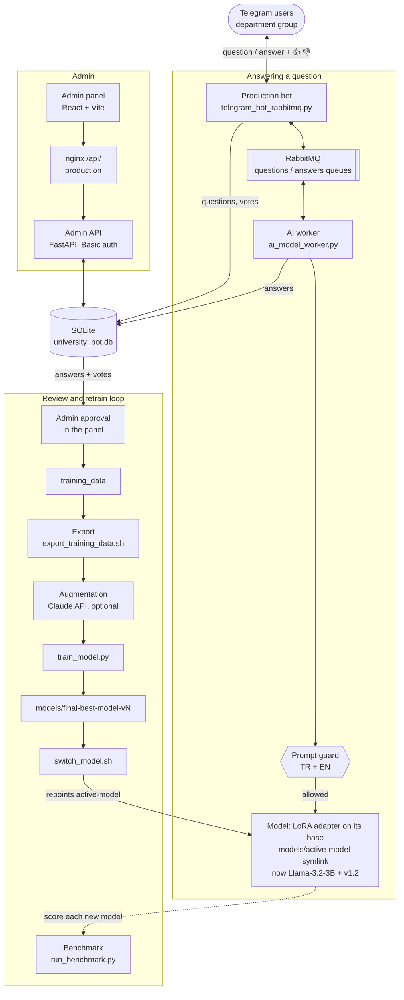

# CengBot System Architecture

## Overview

CengBot consists of a few independent processes that share a RabbitMQ broker
and one SQLite database. The Telegram bot never touches the GPU; only the AI
worker loads the model.

| Process | File | Role | Log (manual mode / systemd) |
|---|---|---|---|
| Telegram bot | `src/telegram_bot_rabbitmq.py` | Receives questions, publishes them, delivers answers, records votes | `logs/bot.log` |
| AI worker | `src/ai_model_worker.py` | Consumes questions, runs the prompt guard and the model, stores and publishes answers | `logs/worker.log` |
| Admin API | `src/admin_rest_api.py` | FastAPI backend of the admin panel (port 8001) | `logs/admin.log` |
| Admin panel | `admin_frontend/` | React + TypeScript + Ant Design, built with Vite (dev server on `localhost:3000`, or the static build served by nginx) | `logs/frontend.log` |
| System monitor | `src/system_monitor.py` | Host, database, process and log-size metrics and alerts (systemd unit only) | `logs/monitor.log`, `logs/system_monitor.log` |
| RabbitMQ | system service (`rabbitmq-server`) | Durable queues `questions` and `answers` | RabbitMQ's own logs |

They are started either by `scripts/start_system.sh` (manual mode: worker, API,
bot, Vite dev server) or by the systemd units `cengbot-worker`, `cengbot-bot`,
`cengbot-admin` and `cengbot-monitor` installed by `scripts/optimize_linux.sh`.
In production `scripts/deploy_production.sh` serves the built panel with nginx,
which proxies `/api/` to the Admin API on `127.0.0.1:8001`.

Other entrypoints, **not for production**:

- `src/telegram_bot.py`: legacy RabbitMQ bot, kept for reference; no script starts it.
- `src/telegram_bot_standalone.py`: optional development bot without RabbitMQ;
  it loads the model in-process and applies the prompt guard itself.

Never run either of them next to the production bot: they poll Telegram with
the same token (Telegram answers the second poller with `409 Conflict`), and the
legacy bot would also consume the same `answers` queue. `start_system.sh` and
`stop_system.sh` stop them if they are running; `health_check.sh` warns about them.

The whole system at a glance (the request path in detail follows below):



## Data Flow

```
┌──────────────┐  1 question   ┌──────────────────────────┐  3 publish   ┌──────────────────────────┐
│ Telegram     │──────────────▶│ telegram_bot_rabbitmq.py │─────────────▶│ RabbitMQ "questions"     │
│ group        │               │  - allowed chat / topic  │              └────────────┬─────────────┘
│              │◀──────────────│  - rate limit            │                           │ 4 consume (prefetch 1)
└──────────────┘  7 reply +    │  - AnswerRouter          │                           ▼
                  👍/👎         └─────┬──────────────▲─────┘              ┌──────────────────────────┐
                                     │2 store       │6 answer            │ ai_model_worker.py       │
                                     ▼  question    │  (routed by id)    │  prompt_guard.guard_input│
                             ┌──────────────────┐   │                    │  llama_model_handler     │
                             │ SQLite           │   │                    │  prompt_guard.guard_output│
                             │ university_bot.db│◀──┼────────────────────│ 5 store answer, publish  │
                             └────────▲─────────┘   │                    └────────────┬─────────────┘
                                      │      ┌──────┴───────────────┐                  │
                                      │      │ RabbitMQ "answers"   │◀─────────────────┘
                                      │      └──────────────────────┘
                             ┌────────┴─────────┐
                             │ admin_rest_api   │◀── admin_frontend (React)
                             └──────────────────┘
```

### Message processing

1. **Filtering.** The bot handles text messages only from the chat
   `TELEGRAM_ALLOWED_CHAT_ID` (default: the department group) and, if
   `TELEGRAM_TOPIC_ID` is set, only from that forum topic. Private chats, other
   groups, commands, blank messages and automatic channel forwards are ignored.
   The only command is `/start`.
2. **Rate limit.** At most 5 messages per user per 60 seconds (sliding window);
   further messages get a "too quickly" reply.
3. **Store.** The question is saved in `raw_data` with the detected language
   (`TR`/`EN`).
4. **Publish.** A waiter is registered in the `AnswerRouter` for the row id,
   then the question is published (persistent message, publisher confirms) with
   `raw_data_id`, `telegram_id`, `username`, `question`, `message_thread_id`,
   `update_message_id`, `chat_id`, `asked_at` and `deliver_until`. Duplicate marking runs in the background
   and does not delay the answer.
5. **Worker.** The worker skips rows that no longer exist; for a row that is
   already answered it publishes the stored answer again (status `resent`)
   instead of generating a new one. Otherwise it runs the prompt guard,
   generates the answer, stores it in `raw_data` (answer, `answered_at`,
   `processing_time`, `model_version`, token counts) and publishes it to
   `answers` with every field of the question plus `answer` and `status`
   (`ok`, `blocked`, `error` or `resent`).
6. **Routing.** A consumer thread in the bot reads `answers` and hands each
   message to the coroutine waiting for that `raw_data_id`. The bot handles
   updates concurrently, so one slow answer never blocks other users.
7. **Reply.** The bot replies to the question in the group (in the same topic),
   echoing the question, with 👍/👎 buttons. Long answers are split into several
   messages within Telegram's length limit. The id of the reply message is stored
   in `raw_data.telegram_message_id`.
8. **Timeout.** If no answer arrives within `BOT_ANSWER_TIMEOUT` seconds
   (default 30), the bot says the answer is on its way and posts it as a reply
   to the question when it arrives within `BOT_LATE_ANSWER_WINDOW` (10 min;
   0 turns late replies off and sends the old fallback reply). The question
   payload carries `asked_at` and `deliver_until`; the worker does not generate
   answers that could no longer reach the asker in time (`deliver_until` minus
   about 4 s; `WORKER_SKIP_EXPIRED`) and notes such rows
   with `[auto]` (admins can still answer them).
9. **Votes.** A button press is accepted only from the allowed chat, only with
   well-formed callback data, and only on the message whose id is stored for that
   question. Each user has one vote per answer and can change it at most twice.
   `raw_data.like` is kept in sync with the votes (1, -1 or NULL by the sign of
   likes minus dislikes).

### Queues and failure handling

- Both queues are durable and messages are persistent. Bot and worker declare
  a queue passively first, so an existing queue is used as it is.
- **Worker start-up.** The model is loaded *before* the worker connects to
  RabbitMQ, with exponential backoff (`WORKER_BACKOFF_INITIAL` 5 s up to
  `WORKER_BACKOFF_MAX` 300 s) and one concise log line per attempt. A model
  that cannot be loaded never causes a busy loop.
- **Reconnects.** Lost RabbitMQ connections are retried with the same backoff,
  but capped at `WORKER_RECONNECT_MAX` (default 15 s; keep it below
  `BOT_ANSWER_TIMEOUT`), so answers resume within the bot's timeout after an
  outage; model-load and unexpected errors keep the 5 s to 300 s backoff. The
  first failure is logged at once, the same error at most every 5 minutes after
  that. A connection that stayed up for `WORKER_HEALTHY_AFTER` seconds (60)
  resets the backoff.
  The bot's answer consumer reconnects with its own backoff (1 s up to 15 s,
  reset after a connection that stayed up 30 s).
- **Heartbeats.** Generation runs in a helper thread while the consumer thread
  keeps servicing the AMQP connection, so a long generation does not miss heartbeats.
- **Poison messages.** A question that fails is republished with an
  `x-cengbot-attempts` header and the original is acknowledged; a redelivered
  message (the worker died while processing it) counts as an attempt too. After
  `WORKER_MAX_ATTEMPTS` (3) attempts the row gets an apology as its answer, the
  user is notified and the message is acknowledged. The worker never uses
  `basic_nack(requeue=True)`. Malformed messages are dropped with a log line.

## Model Layer

`src/llama_model_handler.py` is used by the worker (and by the standalone dev bot).

- **Which model.** `MODEL_PATH`, default `models/active-model`, a symlink
  managed by `scripts/switch_model.sh` (see [MODEL_SWAP.md](MODEL_SWAP.md)).
  The symlink is resolved, and the directory must be either a PEFT LoRA adapter
  (`adapter_config.json` + weights, directly or in the legacy `method1/`
  sub-directory) or a full Hugging Face model. `LORA_MODEL_PATH` is ignored.
- **Any family.** The base can be any causal LM that the installed
  transformers supports natively (Llama, Qwen, DeepSeek distills, Mistral,
  Gemma, Phi, GLM, Granite, OLMo, Falcon3, SmolLM, ...); today it is
  `meta-llama/Llama-3.2-3B`. Code from a model repository is executed only with
  `MODEL_TRUST_REMOTE_CODE=true` (legacy remote-code models; off by default).
  An unsupported architecture or a model that needs remote code fails with a
  clear `ModelLoadError` instead of a transformers traceback.
- **Offline-first.** The base model named in `adapter_config.json`
  (fallback `BASE_MODEL_NAME`) is looked up in
  `MODEL_CACHE_DIR` (`model_cache/`) and in the default Hugging Face cache and
  loaded with `local_files_only=True`. Only if that fails, and downloads are
  allowed (not `HF_HUB_OFFLINE`/`TRANSFORMERS_OFFLINE`, `MODEL_ALLOW_DOWNLOAD`
  not false), is it downloaded into `model_cache/` with `HUGGING_FACE_TOKEN`.
- **Loading.** bfloat16 on CUDA by default (`MODEL_PRECISION`, `USE_CUDA`;
  float32 on CPU). The LoRA weights are merged into the base weights at load
  time for faster decoding (`MODEL_MERGE_LORA`, default true).
  `MODEL_LOAD_IN_4BIT=true` loads the base in 4-bit NF4 instead (bitsandbytes,
  for bases of about 12B and more on a 24 GB GPU); the adapter then stays
  unmerged.
- **Prompt.** The template the adapter was trained with
  (`MODEL_PROMPT_STYLE=training`, default):
  `"{system prompt}\n\nÖğrenci: {question}\nAsistan:"` for Turkish and
  `"{system prompt}\n\nStudent: {question}\nAssistant:"` for English. The
  system prompts are defined once in `llama_model_handler.py`, and
  `src/train_model.py` imports them, so training and inference use the same
  bytes. The prompt is limited to `MODEL_MAX_INPUT_TOKENS` (512); a longer
  question is shortened, never the template.
- **Generation.** Up to `MODEL_MAX_NEW_TOKENS` (200) new tokens (30 for
  greetings), sampling with `MODEL_TEMPERATURE` / `MODEL_TOP_P` / `MODEL_TOP_K`,
  `MODEL_REPETITION_PENALTY`. Generation stops at every end-of-turn token the
  tokenizer and model know (EOS, `generation_config.eos_token_id` and the
  family tokens such as `<|eot_id|>`, `<|im_end|>`, `<end_of_turn>`), at a new
  dialogue turn marker, or as soon as the post-processed answer can no longer
  change (`MODEL_MAX_SENTENCES`, 4, kept sentences complete and a link kept or
  rescued; otherwise up to 4 more sentences, waiting for a link); the answer
  keeps at most one question sentence. `<think>` blocks of reasoning
  models are removed.

## Prompt Guard

`src/prompt_guard.py` is a rule-based, offline filter for Turkish and English,
applied once in the worker before generation (`PROMPT_GUARD_ENABLED`, default on).

- **Input:** Unicode normalisation; removal of zero-width, control and bidi
  characters; a length limit (`PROMPT_GUARD_MAX_CHARS`, 1000); neutralisation
  of role markers (`Student:`, `Asistan:`, `System:`, ...) and special tokens
  (`<|eot_id|>`, `[INST]`, `<<SYS>>`, ...); weighted rules for common
  jailbreak and prompt-injection phrasings, including ASCII-folded Turkish,
  leetspeak and spaced-out letters. Single weak signals never block on their own,
  so ordinary questions ("ignore case in SQL", "act as a TA ...") pass.
- **Blocked input** never reaches the model: the user gets a polite refusal in
  their language, and the row is stored with an `[auto] prompt_guard: ...` note.
- **Output:** the answer is cut at the first generated turn marker, leaked
  special tokens are removed, and an answer that repeats a substantial part of
  the system prompt is replaced with a safe fallback.

Rows answered automatically (refusals, apologies after repeated failures,
answers the output guard replaced with the safe fallback) carry an `[auto]`
note in `admin_notes`. The Admin API refuses to approve them for
training until an admin has edited the answer.

## Data Layer

SQLite (`DATABASE_URL`, default `university_bot.db` in the project root; a
relative path is resolved against the project root, so every process uses the
same file). Models are in `src/database_models.py`; `init_db()` creates missing
tables and indexes (taken from the model metadata) and never drops data;
`src/db_migrations.py` (`--dry-run` first) drops redundant indexes of older
databases and adds missing ones. Every connection uses WAL mode
(`SQLITE_JOURNAL_MODE`, default `wal`), `synchronous=NORMAL` and a 5 s busy
timeout (`SQLITE_SYNCHRONOUS`, `SQLITE_BUSY_TIMEOUT_MS`), so readers never block
the bot's writes. Recent commits live in `university_bot.db-wal`: backups take
an online snapshot (`scripts/backup_data.sh`).

| Table | Content |
|---|---|
| `raw_data` | Every question: asker, question, answer, language, `like`, approval flag, duplicate marking, timestamps, topic, processing time, model version, token counts, admin notes |
| `training_data` | Approved question/answer pairs (`source_id` → `raw_data.id`, unique), duplicate-answer marking, review fields, `is_active` |
| `user_votes` | One row per (question, user) with the current vote and the number of changes (unique index) |
| `user_analytics`, `system_metrics` | Defined in the schema but not filled by any component at the moment |

**Duplicate detection** uses a TF-IDF cosine similarity with Turkish-aware
character folding. A new question is compared with the 100 questions before it
(threshold 0.45) and points to the oldest original; an approved answer is
compared with older training answers (threshold 0.85). The admin API's
`POST /detect-duplicates` recomputes all markings with the same similarity,
thresholds and window; unlike the bot, it ignores texts of 10 characters or fewer.

## Training Pipeline

```
university_bot.db --(database_to_training.py)--> data/cengbot_qa_augmented.jsonl --+
                     (data_augmentation.py: optional, adds variants)                +--> train_model.py --> models/final-best-model-v<N>/
data/merged_qa_data.jsonl (base corpus) --------------------------------------------+        |
                                                                                             v
                                            switch_model.sh --> models/active-model --> benchmark/run_benchmark.py
```

- `src/database_to_training.py` exports active, non-rejected training rows (one
  JSON object per line with `group_id`); by default it merges into the existing
  file and keeps up to 10 backups in `backups/` next to it (`data/backups/` by
  default).
- `src/data_augmentation.py` asks the Claude API for 15 variations per pair;
  variants share the `group_id` of their original.
- `src/train_model.py` cleans and deduplicates the data, builds a group-aware
  train/validation split (an original, its variants, exact duplicates and rows
  that mention the same course code stay on one side), tokenizes with the
  inference prompt and masks the prompt so the loss covers the answer and the
  EOS token only, trains the LoRA adapter (Hugging Face Trainer, early stopping;
  one evaluation pass over a length-sorted validation set gives the
  token-weighted `eval_loss` plus the Turkish and English losses;
  micro-batches of similar length) and writes the model directory atomically. It never changes the active model. The base is `--base-model`
  (default `BASE_MODEL_NAME`); `--load-in-4bit` trains QLoRA for 7-12B bases;
  `--lora-target-modules auto` adapts `q/k/v/o/gate/up/down_proj`, or every
  linear layer for models with fused projections (Phi, GLM); Gemma is trained
  with eager attention. `--resume-from-checkpoint latest` continues an
  interrupted run from its newest complete checkpoint (optimizer, scheduler,
  data position and early-stopping state); it skips the database export and
  refuses to start when the tokenized data differ from the interrupted run
  (`data_fingerprint.json` next to the checkpoints).
- `benchmark/run_benchmark.py` scores a model on 100 verified Turkish and
  English questions through the production path (prompt guard, handler) and
  updates `benchmark/LEADERBOARD.md`; see [benchmark/README.md](../benchmark/README.md).

## Logging and Monitoring

| File | Written by | Rotation |
|---|---|---|
| `logs/worker.log`, `bot.log`, `admin.log`, `frontend.log`, `monitor.log` | stdout/stderr of the services (shell redirect or systemd `StandardOutput=append:`) | logrotate (`config/logrotate/cengbot.conf`: 50 MB, 5 compressed generations, `copytruncate`; `scripts/rotate_logs.sh` first tail-trims logs above 1 GiB) + start-time safety net in `scripts/_common.sh` |
| `logs/error.log` | `src/error_handler.py` (first occurrence of an error with its full traceback; identical errors within `ERROR_DEDUP_WINDOW`, 300 s, as one line with a repeat counter) | Python `RotatingFileHandler`, 10 MB × 5 |
| `logs/system_monitor.log`, `logs/monitoring/*.jsonl` | `src/system_monitor.py` (service mode) | Python `RotatingFileHandler` (10 MB × 3); JSONL entries older than 30 days are dropped |
| `logs/excel_export.log`, `deployment.log`, `optimization.log` | the corresponding scripts | logrotate |
| `logs/training/`, `logs/training_history/`, `logs/training_*.log` | training (`train_model.sh --log-dir DIR` writes them, and the error log, under `DIR`) | not in the logrotate config |

Health checks: `scripts/health_check.sh` (services, `/health`, active model,
resources, log sizes), `GET /health` on the Admin API, and
`src/system_monitor.py --check-logs` / `--once` (exit code 1 on an alert).

## Security Architecture

- **Secrets** only in `.env` (gitignored); `config/env_loader.py` loads it once
  and never overrides variables that are already set. Placeholder values from
  `.env.example` are treated as unset.
- **Admin API**: HTTP Basic auth on every data endpoint (router-level
  dependency), no default password, constant-time comparison. Public: `/`,
  minimal `/health`, OpenAPI docs. The document viewer serves only an allowlist.
  Failed logins (also credentials sent to `/health`) are rate limited per
  client IP: HTTP 429 with `Retry-After` (`ADMIN_LOGIN_*`). Bind to `127.0.0.1`
  behind an HTTPS reverse proxy.
- **Admin panel**: credentials in memory and `sessionStorage` only; production
  builds ship without source maps.
- **Bot**: answers only in the allowed chat; user and model text is
  HTML-escaped in replies; callback data is validated and checked against the
  stored message id.
- **Model**: blocked prompts never reach the model; offline loading can be
  enforced with `MODEL_ALLOW_DOWNLOAD=false` or `HF_HUB_OFFLINE=1`; code from a
  model repository runs only with `MODEL_TRUST_REMOTE_CODE=true`.
- **Scripts**: root actions use interactive `sudo` (no stored passwords);
  `setup_system.sh`, `optimize_linux.sh` and `deploy_production.sh` ask before
  changing the system (`start_system.sh` installs/starts RabbitMQ and
  `switch_model.sh` restarts a systemd worker through `sudo` without a
  question), and only processes of this project are stopped. Services started by the scripts never inherit the locks
  of `train_model.sh` or `switch_model.sh`.

## Technology Stack

- **Backend:** Python 3.11, FastAPI + uvicorn, SQLAlchemy 2.0 + SQLite, pika
  (RabbitMQ), python-telegram-bot 20.7
- **ML:** PyTorch, transformers, PEFT, accelerate, datasets, bitsandbytes
  (QLoRA training and optional 4-bit inference), langdetect,
  sentence-transformers (optional); base model today Llama-3.2-3B, any
  natively supported open-weight family possible
- **Frontend:** React 18, TypeScript 5.9, Ant Design 5, TanStack Query, axios;
  Vite 8 (dev server and build), Vitest 5 + Testing Library (tests); Node.js
  22.13+ or 24+
- **Evaluation:** `benchmark/` (deterministic grader, optional LLM judge via
  the Claude API)
- **Operations:** bash scripts, systemd, logrotate, nginx (static panel and
  `/api/` proxy, via `scripts/deploy_production.sh`)
